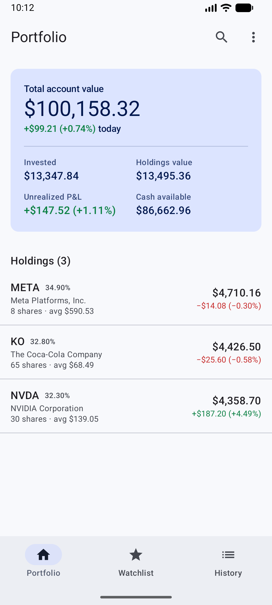
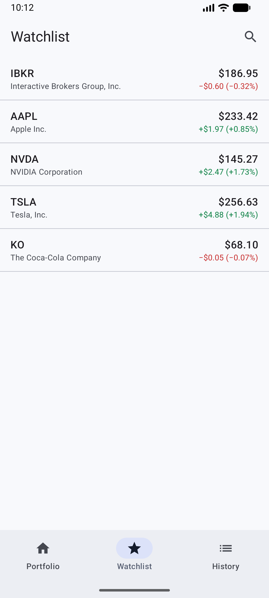
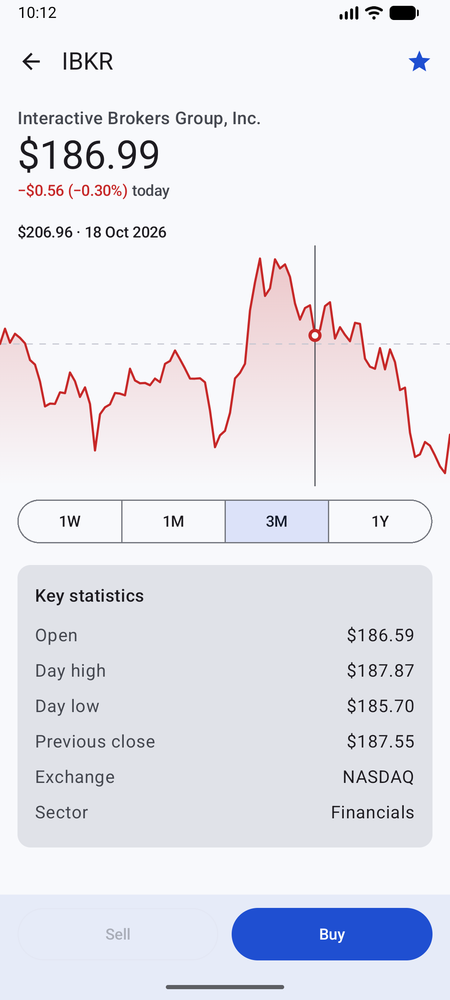
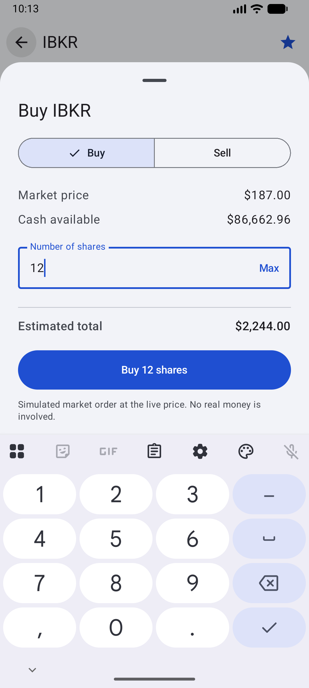
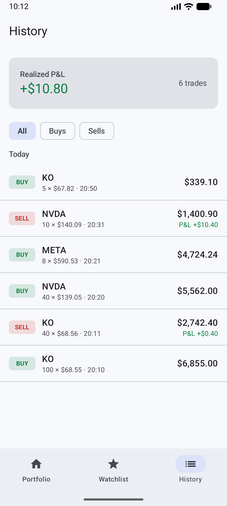
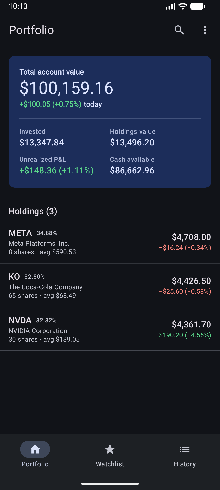
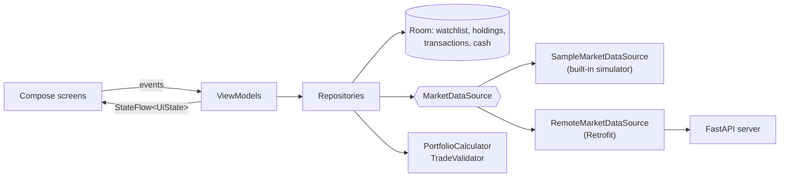

# PortfolioX – Stock Portfolio Manager

A native Android app for managing a simulated stock portfolio: search stocks, follow live prices on a watchlist, read historical charts, place simulated buy and sell orders, and track holdings, profit and loss, and transaction history. It comes with a small FastAPI server, so market data can come from a real REST API.

Built with Kotlin, Jetpack Compose, MVVM, Coroutines/Flow, Room and Retrofit.

| Portfolio | Watchlist | Stock detail | Trade | History | Dark mode |
|---|---|---|---|---|---|
|  |  |  |  |  |  |

## Features

- **Portfolio dashboard:** total account value, today's change, amount invested, unrealized P&L and cash, plus holdings sorted by value with their share of the portfolio. Everything updates live.
- **Watchlist:** live prices; swipe to remove, with undo that restores the original position.
- **Search:** by symbol or company name, debounced as you type; a star adds or removes a stock from the watchlist.
- **Stock detail:** live quote, key statistics, your position, and a hand-drawn price chart (1W / 1M / 3M / 1Y) where you drag to read any point.
- **Simulated trading:** buy and sell market orders at the live price, with validation as you type (cash, shares owned, quantity) and atomic execution.
- **Transaction history:** grouped by day, filterable by buys and sells, with realized P&L per sell and in total.
- **Reset portfolio** for a clean demo, dark mode, large-font support, and state restored after rotation or process death.

## Tech stack

| Area | Choice |
|---|---|
| Language | Kotlin |
| UI | Jetpack Compose, Material 3, Navigation Compose (type-safe routes) |
| Architecture | MVVM, repository pattern, manual dependency injection |
| Async | Kotlin Coroutines and Flow |
| Persistence | Room (SQLite) |
| Networking | Retrofit, OkHttp, kotlinx.serialization |
| Testing | JUnit 4, kotlinx-coroutines-test, Room in-memory tests, pytest |
| Backend | FastAPI (Python) mock market data server in `server/` |

## Architecture



- **Unidirectional data flow:** screens render a single `UiState` (Loading, Success, Empty or Error) and send events. ViewModels own the state.
- **Room is the single source of truth** for everything the user owns. Screens observe Flow queries, so a trade updates every screen without any refresh code.
- **Market data sits behind an interface.** The simulator and the REST API are interchangeable through one line in `AppContainer`.
- **Business rules are pure Kotlin** (`domain/`), with no Android imports, and unit tested in isolation.
- **Money is `BigDecimal`** end to end. It is stored as TEXT in SQLite and sent as JSON strings, never as floating point.
- **Trades are atomic:** validation, holding update, cash update and the history record run in a single database transaction.

## Project structure

```
app/src/main/java/com/portfoliox/
├── di/        AppContainer: creates and wires every dependency once
├── core/      Formatters for money, percentages and dates
├── domain/    Models, PortfolioCalculator, TradeValidator (pure Kotlin)
├── data/
│   ├── local/     Room entities, DAOs, database, TransactionRunner
│   ├── market/    MarketDataSource interface, sample simulator, Retrofit remote source
│   └── repository/ Market, Watchlist and Portfolio repositories
└── ui/        Compose screens + ViewModels per feature, navigation, theme
server/        FastAPI market data server with pytest suite
docs/          Screenshots and interview notes
```

## Running

1. Open the project in Android Studio and wait for Gradle sync.
2. Choose an emulator or device and press **Run**.

By default the app uses the built-in market simulator and needs no setup.

### With the FastAPI backend

```powershell
cd server
py -m venv .venv
.venv\Scripts\python -m pip install -r requirements-dev.txt
.venv\Scripts\python -m uvicorn app.main:app --host 127.0.0.1 --port 8000
adb reverse tcp:8000 tcp:8000
```

Then set `portfoliox.marketDataSource=remote` in `gradle.properties` and run the app. API docs are at http://localhost:8000/docs. See [server/README.md](server/README.md) for details.

## Testing

| Command | What it runs |
|---|---|
| `./gradlew testDebugUnitTest` | JVM unit tests: domain rules, repositories with fakes, ViewModels with virtual time, JSON parsing, polling and backoff |
| `./gradlew connectedDebugAndroidTest` | Room tests on a device: SQL, type converters, transaction rollback, reset |
| `./gradlew lintDebug` | Android Lint |
| `server\.venv\Scripts\python -m pytest server` | FastAPI endpoint tests |
